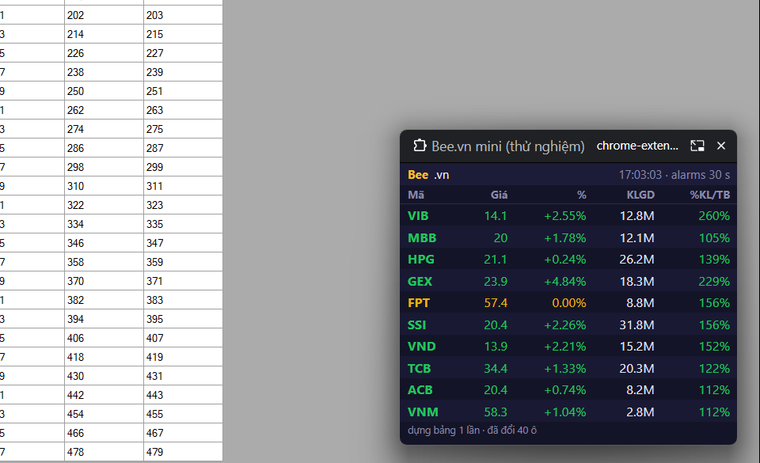
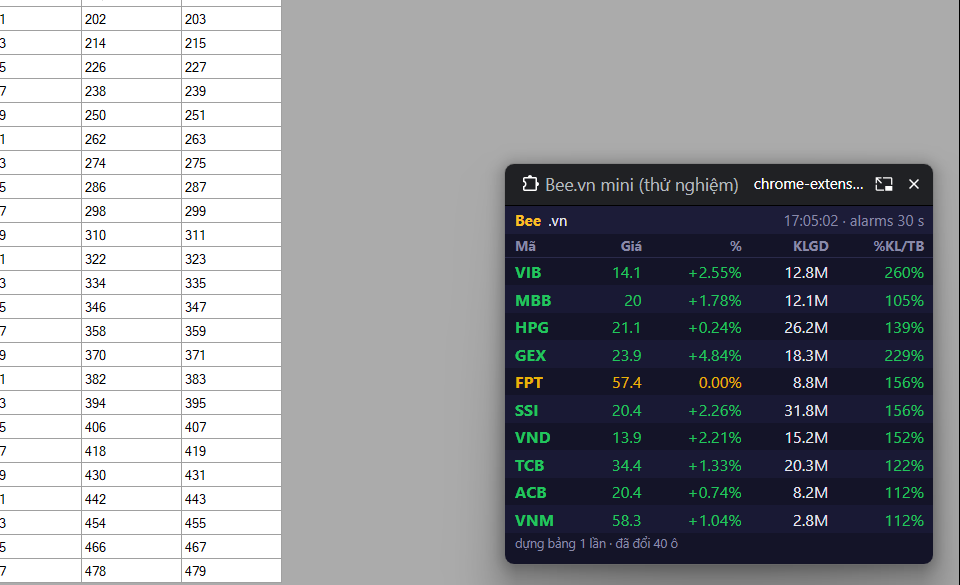

# Báo cáo bản thử Chrome extension — Bee.vn mini

Gửi anh. Em làm bản thử trong `chrome-ext/` và chạy nó trên **Chrome 155 thật** của máy này,
dùng một hồ sơ Chrome riêng: nạp extension, bấm các nút như người dùng, chụp màn hình. Bản thử chạy
lúc 16:59–17:05 ngày 21/10/2026, **sau giờ giao dịch**.

**Kết luận: cả 4 điểm đều làm được.** Có một chỗ hỏng: cửa sổ nổi **không mở được từ side panel**,
chỉ mở được từ một tab của extension. Kèm theo đó là vài hạn chế cố hữu của Chrome, ghi ở cuối mục 2.

| # | Điểm cần kiểm | Kết quả |
|---|---|---|
| 1 | Gọi giá FireAnt + nến VNDirect từ extension | ✔ Chạy được |
| 2 | Cửa sổ nổi Document PiP, đè lên ứng dụng khác | ✔ Mở được từ tab của extension · ✘ Không mở được từ side panel |
| 3 | Tự cập nhật 30 s, không nhấp nháy | ✔ Chạy được, kể cả khi Chrome thu nhỏ |
| 4 | Đọc tên mã bằng giọng Việt | ✔ Chạy được với giọng Windows “Microsoft An” |

---

## 1. Gọi API — ✔ chạy được

- **FireAnt** `Markets/Quotes?symbols=…`: lấy đủ 10/10 mã, mất 100–550 ms mỗi lần.
- **VNDirect** `dchart/history?resolution=D`: lấy đủ 10/10 mã, mỗi mã 70 nến ngày. Từ đó tính được
  KL trung bình 45 phiên, nên cột %KL/TB có số (vd VIB 260%).
- Khai báo `host_permissions` cho hai tên miền là gọi được thẳng, **không vướng CORS**.
- `fetch` trong Chrome không cho đặt `User-Agent`, nên Chrome gửi UA của chính nó. API Quotes vẫn nhận bình thường.
- Dchart không cần làm gì thêm: `Accept` mặc định của `fetch` là `*/*`, nên không dính lỗi 406 như khi hỏi đích danh `application/json`.

**Chưa thử, cần làm khi chuyển hẳn:**
- `TradingStatistic` đòi đúng header `Cookie` và `User-Agent` riêng (xem `core.fetch_trading_stats`).
  `fetch` không đặt được hai header này. Phải đặt bằng luật `declarativeNetRequest` (modifyHeaders).
  Về lý thuyết là làm được, nhưng em chưa thử.
- Đọc cookie từ Google Sheet cần thêm quyền vào `docs.google.com`.
- Có thể còn cách gọn hơn: nếu anh đã đăng nhập fireant.vn ngay trong Chrome, extension có thể
  gửi luôn cookie của trình duyệt và bỏ được cái Google Sheet. Cách này phải thử mới biết.

## 2. Cửa sổ nổi luôn trên cùng — ✔ từ tab extension, ✘ từ side panel

- **Từ tab của extension** (bấm nút *Mở cửa sổ nổi*): mở được. Cửa sổ ra **góc dưới-phải màn hình**,
  đúng cỡ đã xin (~340×290). Nó **nổi đè lên một cửa sổ khác đang phóng to và đang được chọn**
  (ảnh 1: cửa sổ giả làm Excel). Kéo đi và đổi cỡ được; anh kéo cỡ một lần thì lần sau Chrome nhớ cỡ đó.
  Giao diện tối, dùng đúng bảng màu của app.
- **Từ side panel**: `documentPictureInPicture` có trong side panel, nhưng cửa sổ mở xong là **tự đóng sau 3–6 ms**.
  Em thử 3 lần, lần nào cũng vậy → không dùng được side panel cho việc này.

**Hạn chế cố hữu của Chrome:**
1. **Phải bấm chuột một lần để mở.** Chrome bắt mở PiP phải từ một cú bấm của người dùng, nên mỗi lần
   mở lại Chrome anh phải bấm nút một lần. Không tự bật lên lúc khởi động như app hiện nay được.
2. **Cửa sổ nổi sống theo tab đã mở nó.** Đóng tab là cửa sổ nổi đóng theo. Em đã ghim tab và tắt
   tự giải phóng tab (`autoDiscardable: false`). Chrome cũng phải đang chạy (thu nhỏ thì không sao).
3. **Có thanh tiêu đề của Chrome** (tên extension + địa chỉ `chrome-extension://…` + nút đóng).
   Không bỏ được, nên không có viền gọn như cửa sổ Tkinter tự vẽ.
4. Theo em biết, Chrome chỉ cho **một cửa sổ PiP một lúc**. Nếu anh bật PiP cho video
   (YouTube…) thì bảng giá có thể bị đóng. Em chưa thử điểm này.

## 3. Tự cập nhật 30 s, không nhấp nháy — ✔ chạy được

- Service worker dùng `chrome.alarms` mỗi 30 s (mức tối thiểu Chrome cho phép) để báo cho tab,
  tab lấy giá và đổi chữ trong ô. Có sẵn lựa chọn `setInterval` để so, nhưng em mới chỉ thử `chrome.alarms`.
- Em **thu nhỏ hẳn cửa sổ Chrome** rồi chờ 95 s. Khoảng cách giữa các lần cập nhật là
  **29,8 · 30 · 30 giây**. Cửa sổ nổi ghi “17:05:02” khi đồng hồ thật là 17:05:03, tức là nó vẫn cập nhật
  dù tab đang ẩn (ảnh 2).
- **Không dựng lại bảng.** Bảng chỉ dựng một lần; mỗi lượt sau chỉ đổi chữ hoặc màu của những ô thật sự khác.
  Chân cửa sổ ghi “dựng bảng 1 lần · đã đổi 40 ô” sau nhiều lượt. Vì không có phần tử nào bị tạo lại
  nên không có gì để nhấp nháy.
- *Lưu ý:* thử sau giờ giao dịch nên giá không đổi; chỉ có giờ ở đầu bảng nhảy mỗi 30 s. Anh nên xem thêm
  một lúc **trong giờ giao dịch** cho chắc mắt.
- Trong lúc thử, em tìm ra và **đã sửa** một lỗi: bấm “Mở cửa sổ nổi” lần hai khi cửa sổ cũ còn mở thì
  cửa sổ mới đứng hình, không cập nhật nữa.

## 4. Đọc tên mã giọng Việt — ✔ chạy được

- Cả **`chrome.tts`** lẫn **Web Speech** đều thấy và đọc được bằng giọng
  **“Microsoft An - Vietnamese (Vietnam)”**. Đây đúng là giọng mà app hiện tại gọi qua `speak.ps1`.
  Em đã nhận sự kiện bắt đầu và kết thúc đọc của câu “G E X”.
- Có một bẫy đã xử lý trong code: lúc trang vừa mở, Chrome chỉ liệt kê 19 giọng Google (đều đọc qua mạng,
  không có tiếng Việt). Vài giây sau danh sách mới thêm các giọng Windows, trong đó có Microsoft An.
  Code liệt kê lại mỗi khi danh sách đổi.
- Máy nào chưa cài giọng tiếng Việt của Windows thì cũng không có giọng Việt, giống app hiện nay.
  Nút *Google Dịch* là đường dự phòng **không chính thức** (endpoint `translate_tts`), chỉ để so sánh,
  không nên dựa vào.

---

## Ước lượng công chuyển toàn bộ app

Hiện có khoảng 3.000 dòng Python (chưa tính `tests/` và các thay đổi 1.7.0 pullback/trendline chưa commit):

| Phần | Nội dung | Công |
|---|---|---|
| Logic | `core.py` + `conditions.py` + `tech.py` + `symbols.py` (~1.400 dòng) dịch sang JS gần như 1-1; chuyển `tests/` sang JS và so kết quả với bản Python trên cùng dữ liệu | 3–4 ngày |
| Giao diện | `beevn_mini.pyw` (~1.600 dòng Tkinter: bảng theo tiêu chí, danh mục theo dõi, thu gọn/đầy đủ, hộp Cài đặt, ô nhập tiêu chí, báo mã mới) → HTML/CSS trong tab + PiP | 4–5 ngày |
| Hạ tầng | Lưu cài đặt (`chrome.storage`), cache nến ~1.600 mã (IndexedDB), giới hạn số yêu cầu đồng thời, hàng đợi đọc, cookie TradingStatistic qua `declarativeNetRequest` | 2–3 ngày |
| Chạy song song | Chạy cạnh bản Python trong giờ giao dịch, sửa chỗ lệch | 2–3 ngày |
| **Tổng** | | **khoảng 11–15 ngày công (2–3 tuần)** |

Nên chốt bản Python nào làm gốc (1.6.0 hay 1.7.0) trước khi chuyển, để khỏi phải chuyển hai lần.

Phát hành: dùng riêng thì *Load unpacked* là đủ. Muốn đưa cho người khác cài dễ thì phải qua Chrome Web Store
(tài khoản nhà phát triển trả phí một lần, mỗi bản cập nhật phải chờ duyệt).

**Ý kiến của em:** về kỹ thuật thì chuyển được. Điều anh cần cân nhắc là trải nghiệm: phải bấm một lần
mỗi khi mở Chrome, cửa sổ có thanh tiêu đề Chrome, và Chrome phải luôn chạy. Nếu anh chấp nhận được
ba điều đó thì có thể chuyển.
